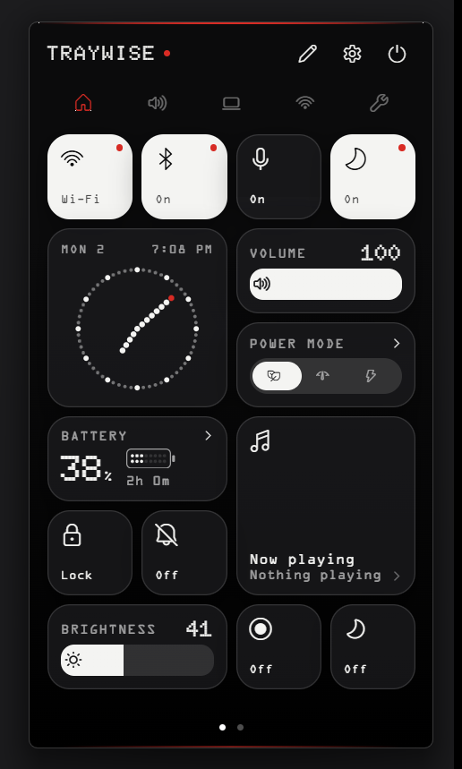
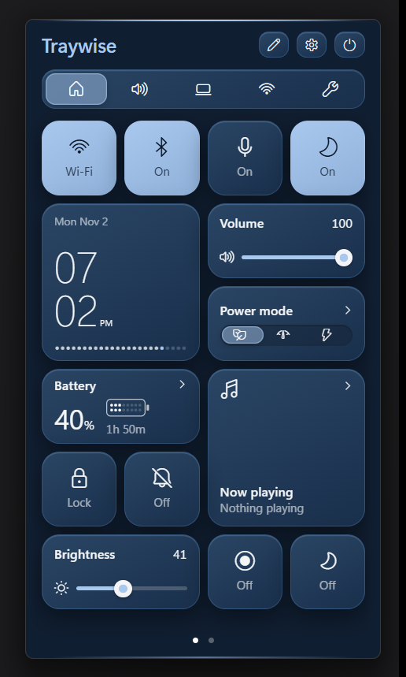
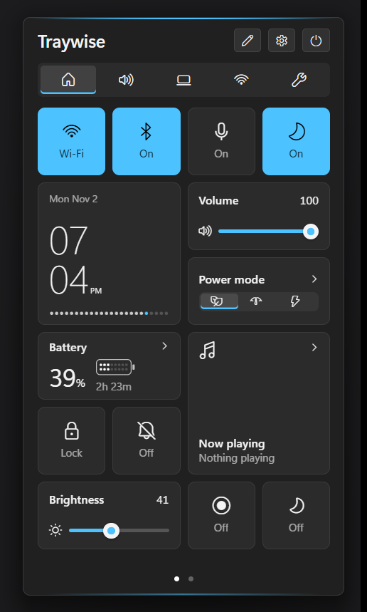

<div align="center">

# Traywise

**One tray icon. One panel. Small Windows 11 tools you switch on only when you want them.**

[](https://github.com/SA-Kathir/traywise/actions/workflows/ci.yml)
[](https://github.com/SA-Kathir/traywise/releases/latest)
[](https://github.com/SA-Kathir/traywise/releases)
[](LICENSE)






[Install](#install) · [Modules](#modules) · [Looks](#looks) · [Build from source](#build-from-source) · [Contributing](#contributing) · [Roadmap](docs/ROADMAP.md)

</div>

## Why Traywise

Windows hides its everyday controls behind several menus and Settings pages. Traywise puts the useful ones in a single panel, one click from the tray, and keeps out of your way the rest of the time.

- **Fast and lean.** The panel opens in tens of milliseconds, sits at about 0% CPU while hidden, and shuts its page down after a long idle. It's event-driven, with no polling.
- **Modular.** Every feature is a module. A module that's switched off doesn't run at all: no threads, no hooks, and its UI code isn't even loaded.
- **Yours to arrange.** Home is a board of tiles you move, resize and add, on up to five swipeable pages.
- **Good-looking.** Four looks, from a monochrome dot-matrix style to translucent glass.
- **Private.** No accounts, no telemetry, no analytics. Everything runs locally.
- **Free and open source**, under the GPL.

## Install

1. Download `Traywise_x.y.z_x64-setup.exe` from the [latest release](https://github.com/SA-Kathir/traywise/releases/latest).
2. Run it. It installs for your user only, so it doesn't ask for admin rights.
3. **Windows SmartScreen will warn you** ("Windows protected your PC"), because Traywise isn't code-signed yet. Click **More info**, then **Run anyway**.

Traywise updates itself: it checks for a new version when it starts and once a day, and asks before installing. The download and install happen inside Traywise (with a progress bar) and it restarts by itself. You can turn the checks off in Settings.

To uninstall, use **Settings → Apps → Installed apps → Traywise**.

**Requirements:** Windows 11 (64-bit). WebView2 is built into Windows 11.

## Using it

- **Open or close the panel:** left-click the tray icon, or press **Ctrl+Alt+T**. **Esc** goes back a page, then closes the panel. It opens in the corner of the screen the mouse is on.
- **Tray menu:** right-click the icon for Settings, Mute microphones, Keep awake and Quit.
- **Open from the screen edge:** in **Settings → Opening**, rest the mouse on the middle of the left or right edge of a screen and the panel slides in.
- **Home board:** tap the pencil (or hold a tile) to move, resize, remove or add tiles, from 1×1 up to 4×2. Picking a tile in Add tiles shows it live, with ‹ › to swipe through its sizes and variants.
- **Pages:** swipe between up to five board pages (touchpad, touchscreen, Shift + mouse wheel, Ctrl+← / Ctrl+→, or the dots).
- **Other tabs** (Sound, System, Connect) hold each module's full controls.

## Modules

Switch each on or off in **Settings → Modules**.

| Module | What it does |
|---|---|
| **Volume mixer** | Volume and mute for each app playing sound, plus the master volume, as a ring, a dial or sliders. Send an app to another output device. |
| **Now playing** | What any app is playing, with cover art, play/pause, skip, a seek bar, shuffle and repeat. |
| **Audio devices** | Choose the default speakers and microphone in one click; mute every microphone at once (Ctrl+Alt+M by default). Optionally lowers the speakers when your headphones disconnect. |
| **Keep awake** | Stop the PC sleeping: until you turn it off, for a set time, while plugged in, or while an external screen is connected (Docked). |
| **System monitor** | CPU, memory, GPU, network speed and totals, local IP, battery and free disk space, with a 60-second graph. It only measures while the panel is open. |
| **Wi-Fi** | Switch it on or off, see the current network with its signal, band and security, and join another. |
| **Bluetooth** | Switch it on or off, see paired devices, and connect or disconnect headphones and speakers in one tap. |
| **Quick toggles** | Light/dark mode, desktop icons, lock the screen, Airplane mode and Mobile hotspot. |
| **Displays** | Brightness for each screen, refresh rate, and Project (PC screen only, Duplicate, Extend, Second screen only). |
| **Power** | Windows' power mode, the battery with time left, and whether Energy saver is on. |
| **Clock** | Time and date as a digital or analogue tile, with an optional second time zone. |
| **Focus** | Do not disturb with a Pomodoro-style cycle of focus and rest rounds, as an arc or an hourglass, with an optional chime. |

## Looks

Pick one when you first start Traywise, and change it any time in Settings.

- **Dot** (default): monochrome tiles, dot-matrix numbers and one accent colour, following Windows' light or dark mode.
- **Tint**: tiles tinted in one of six colours, on a deep shade of the same colour.
- **Windows**: flat, like Windows 11's own flyouts.
- **Glass**: Windows blurs the desktop behind a transparent panel, with dark translucent tiles and a lit rim. Choose a Vivid or Soft style, or a Clear background that leaves only the tiles floating.

The written spec is in [docs/design-system.md](docs/design-system.md).

## Privacy

Traywise works locally. It has no accounts, no telemetry and no analytics.

- It doesn't look at your screen or wallpaper, with one small exception: with a **Transparent** Dot background or the **Glass** look, as the panel opens it measures how bright the area behind it is (shrunk to 8 × 8 pixels and averaged into one number). The sample is deleted at once; nothing is saved or sent.
- The **Wi-Fi** module shows network names, which Windows 11 counts as location use. You'll see Windows' location icon while it reads them, and it only can if location is on for desktop apps.
- The only network request is the update check (a request to GitHub for the latest version, and a download if you choose to install). You can turn it off in Settings.

Settings are saved in `%APPDATA%\Traywise\settings.json`.

## Build from source

You need [Node.js](https://nodejs.org/) 22+, [pnpm](https://pnpm.io/), [Rust](https://rustup.rs/) (stable) and the [Tauri prerequisites for Windows](https://tauri.app/start/prerequisites/).

```bash
pnpm install
pnpm tauri dev      # run with hot reload
pnpm tauri build    # installer in src-tauri/target/release/bundle/nsis/
```

Checks:

```bash
pnpm test                          # UI logic tests
pnpm exec tsc --noEmit             # type-check
cd src-tauri && cargo clippy && cargo test
```

Only one Traywise can run at a time, and `pnpm tauri dev` uses port 1420.

### Built with

[Tauri 2](https://tauri.app/) (shell, tray, installer), Rust with Microsoft's [`windows`](https://github.com/microsoft/windows-rs) crate for everything that talks to Windows, and React + TypeScript + Vite for the UI. Rust types are generated into TypeScript, so the UI never hand-writes the shape of data from Rust.

## Contributing

Contributions are welcome. Read [CONTRIBUTING.md](CONTRIBUTING.md) first: it covers the code layout, branches (work goes on `feature/<name>` or `fix/<name>` from `dev`) and Conventional Commit messages. For bugs and ideas, [open an issue](https://github.com/SA-Kathir/traywise/issues).

Traywise is not a launcher, so clipboard history, snippets, notes, calculators and web search are out of scope. See [docs/ROADMAP.md](docs/ROADMAP.md) for what's released, in progress and next, and [CHANGELOG.md](CHANGELOG.md) for each release's notes.

## Licence

Traywise is free software under the [GNU GPL v3.0 or later](LICENSE).

It bundles two fonts: [Doto](https://github.com/oliverlalan/Doto) (SIL Open Font License 1.1) and [OCR-A](https://sourceforge.net/projects/ocr-a-font/) by John Sauter (public domain). Their licences are installed with the app, in the `licenses` folder.

Inspired by vorssaint-utils for macOS. Traywise is a separate project and shares no code with it.
