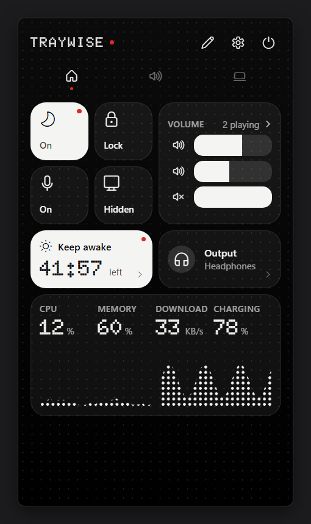
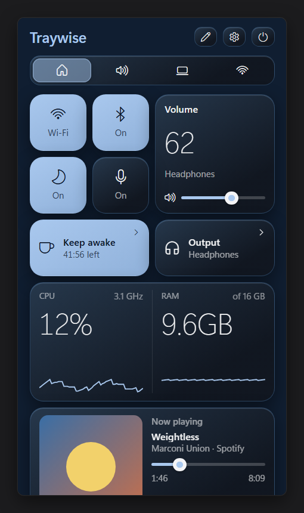
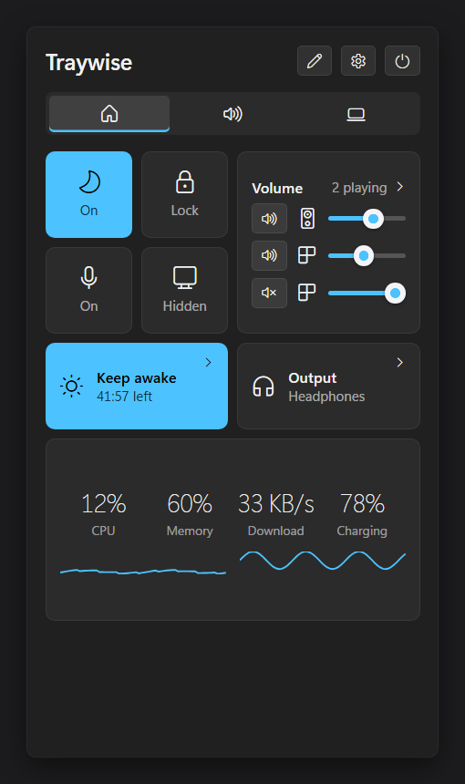

# Traywise

One tray icon, one panel, and a handful of small Windows 11 tools you can switch on or off.

<p align="center">
  
  
  
</p>

Pick a look when you first start it, and change it any time in Settings:

- **Dot** (the default): monochrome tiles over a dot grid, dot-matrix numbers and one accent colour (red, amber, violet, blue or green), following Windows' light or dark mode.
- **Liquid**: tiles tinted in one of six colours, on a tinted background or floating over your desktop.
- **Windows**: flat, like Windows 11's own flyouts, following Windows' light or dark mode.

## Modules

Each module can be switched on or off in **Settings → Modules**. A module that's off doesn't run at all.

- **Volume mixer**: the volume and mute of each app that's playing sound, plus the master volume.
- **Now playing**: what any app is playing (Spotify, a browser tab, a video player), with its cover art, play/pause, skip, a seek bar, shuffle and repeat. The Sound tab lists every app with media.
- **Audio devices**: pick the default speakers or headphones in one click, and mute every microphone at once (also with a shortcut, Ctrl+Alt+M by default).
- **Keep awake**: stop the PC from sleeping, until you turn it off, for a set time, or while plugged in. Can keep the screen on too.
- **System monitor**: CPU, memory, network speed, battery and free disk space, with a 60-second graph. It only measures while the panel is open.
- **Quick toggles**: switch Wi-Fi and Bluetooth on or off, switch light/dark mode, show or hide desktop icons, and lock the screen.

Left-click the tray icon, or press **Ctrl+Alt+T** (change it in Settings → Shortcuts), to open or close the panel. Modules are grouped into tabs (Home, Sound, System), and Settings and Quit are at the top of the panel; you can also right-click the tray icon to quit.

## Install

1. Download `Traywise_x.y.z_x64-setup.exe` from the [latest release](https://github.com/SA-Kathir/traywise/releases/latest).
2. Run it. It installs for your user only, so it doesn't ask for admin rights.
3. **Windows SmartScreen will warn you** ("Windows protected your PC"), because Traywise isn't code-signed yet. Click **More info**, then **Run anyway**. Signing is planned.

Traywise updates itself: it checks for a new version when it starts and once a day, and asks before installing. You can turn the checks off in Settings.

To uninstall, use **Settings → Apps → Installed apps → Traywise**.

## Requirements

- Windows 11 (64-bit).
- WebView2, which is built into Windows 11.

## Privacy

Traywise works locally. It has no accounts, no telemetry and no analytics, and it never reads your screen or wallpaper.

The only thing it sends over the network is the update check: a request to GitHub for the latest version's details, and a download if you choose to install. You can turn this off in Settings.

Your settings are saved in `%APPDATA%\Traywise\settings.json`.

## Build from source

You need [Node.js](https://nodejs.org/) 22+, [pnpm](https://pnpm.io/), [Rust](https://rustup.rs/) (stable) and the [Tauri prerequisites for Windows](https://tauri.app/start/prerequisites/).

```bash
pnpm install
pnpm tauri dev
```

`pnpm tauri dev` runs it with hot reload. For a release build, run `pnpm tauri build`; the installer ends up in `src-tauri/target/release/bundle/nsis/`.

See [CONTRIBUTING.md](CONTRIBUTING.md) for how the code is laid out.

## Licence

Traywise is free software under the [GNU GPL v3.0 or later](LICENSE).

Inspired by vorssaint-utils for macOS. Traywise is a separate project and shares no code with it.
